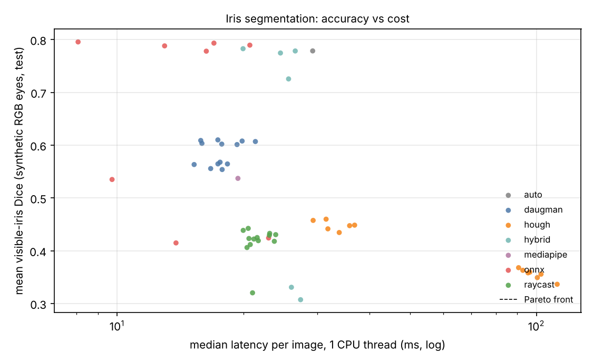

# A-EYE iris pipeline – benchmark results

_Generated by `python -m bench.report` from the CSVs in `results/`. All numbers measured in this repository's container (4 vCPU, no GPU). Data: see `data/DATASETS.md` (research-only licences)._

## 1. Recommendation

**Shipped default: `auto` segmenter** (see the explanation below the programmatic result).

* **Pixel-metric winner (programmatic, masked test sets only):** `onnx|model=seg_small_160.onnx` – iris Dice 0.796, failure rate 0.280, p95 11 ms/image, model 3.8 MB.
* **Highest mean iris Dice:** `onnx|model=seg_small_160.onnx` – iris Dice 0.796, p95 11 ms.
* Selection rule: cheapest config (p95 latency + 20 ms per MB of model) whose mean iris Dice is within 0.01 of the best and whose failure rate (Dice < 0.8) is within 2 points of the best.

### Why `auto` and not the programmatic pixel-metric winner

The rule above picks `onnx|seg_small_160` because it wins on the datasets that have masks
(visible-light synthetic renders and real NIR). The real-photo check changes the answer:
on **real visible-light iris close-ups** (UPOL; the closest public match to iridology/A-EYE
macro photos) the learned model fails on 30/30 held-out images (the limbus is badly
underestimated; it never saw real high-resolution iris texture filling the frame), while
the classical Daugman operator passes 28/30.

The shipped default is therefore **`auto`** (`aeye_iris/pipeline.yaml`). It always runs Daugman (~40–60 ms). If the
iris radius is ≥ 0.40 of the short image side (an iris-filling close-up) it keeps that result.
Otherwise it runs the 3.8 MB MobileNetV3-small/160 model (~8–12 ms). The 0.40 threshold came
from the *validation* splits only: close-ups are ≥ 0.43 (5th percentile) and whole-eye framing is ≤ 0.38 (95th percentile).

| | `auto` (default) | learned small_160 | Daugman (best classical) |
|---|---|---|---|
| Real NIR iris Dice (held-out subjects) | 0.913 | **0.917** | 0.571 |
| Visible-light synthetic iris Dice | 0.779 | **0.795** | 0.609 |
| Real close-ups, visual pass (30 held-out) | **28/30** | 0/30 | **28/30** |
| Latency per eye, 1 thread | ~30–55 ms | ~8–12 ms | ~16–60 ms |
| Model size | 3.8 MB | 3.8 MB | 0 |

### What was tried and rejected (and why)

* **Bigger / higher-resolution networks** (MobileNetV3-large 224, small 224/320): no accuracy gain over
  small_160 on any test set, 1.5–2.5x slower → rejected.
* **INT8 static quantisation** (ONNX Runtime QDQ): no speed-up on this x86 CPU and large accuracy
  loss (small_160: NIR Dice 0.92 → 0.64 even with percentile calibration and a float head). The large model
  keeps more accuracy (0.89) but is slower than FP32 small_160. Would need quantisation-aware training → rejected.
* **Model + classical edge refinement (`hybrid`, band)**: slightly worse than the model alone everywhere → rejected.
* **Model pupil + classical limbus search (`hybrid`, search)**: 27/30 on real close-ups but worse
  on periocular framing than `auto` → rejected in favour of `auto`.
* **MediaPipe iris landmarks**: its iris radius is a fixed fraction (~9%) of the crop regardless of the true
  size (measured), so it is only a centre proposer here; with a classical radius search it reaches
  0.43 (NIR) / 0.54 (synthetic) iris Dice → rejected.
* **Hough circles**: worst classical method (0.33–0.46 iris Dice, and the slowest at up to 100+ ms with CLAHE) → rejected. **Ray-cast + RANSAC ellipse**:
  below Daugman on every set.
* **Preprocessing**: CLAHE is the single most useful option for all classical methods (+0.04–0.08 Dice);
  red vs gray vs V channel differ by < 0.01; specular-reflection inpainting matters on NIR (+0.08 Dice
  with CLAHE: strong corneal glints) and is neutral on RGB, so it stays on.
* **Colour**: hand-set CIELAB rules reach only 0.52 macro-F1 under a warm camera cast; a 5-feature
  logistic model (≈ 20 numbers, numpy inference) reaches 0.88 → learned, but must be re-fitted per camera / on A-EYE photos.
* **Quality gate**: a logistic model over all metrics (AUC 0.91) beats per-metric thresholds (AUC 0.78);
  JPEG artefacts are barely detected by any metric.

### Data reality check

* UBIRIS.v2 could not be used: the Kaggle mirror ships the images inside a password-protected archive
  (the password is issued by the authors with the research licence); only its masks were readable.
* About 1 in 10 Synthetic-Human-Eyes masks still disagree with the image after automatic QC (eyelid/gaze
  mismatch in the source data), which caps every method's measured Dice on that set (same for all methods).
* No public dataset labels the six SRS markings; their numbers come from synthetic injection only.

## 2. Segmentation (visible-light synthetic eyes, held-out renders)

Pareto front (no config is both faster and more accurate):

| config | iris Dice | fail rate | E1 | pupil Dice | ms p50 | ms p95 | MB |
|---|---|---|---|---|---|---|---|
| onnx|model=seg_small_160.onnx | 0.796 | 0.280 | 0.044 | 0.769 | 8.071 | 10.867 | 3.840 |

All segmentation configs

| config | Dice mean | Dice median | fail | HD95 px | pupil Dice | pupil ctr err | ms p50 | ms p95 | ok |
|---|---|---|---|---|---|---|---|---|---|
| onnx|model=seg_small_160.onnx | 0.796 | 0.902 | 0.280 | 9.550 | 0.769 | 0.072 | 8.071 | 10.867 | 1.000 |
| onnx|model=seg_large_224.onnx | 0.793 | 0.916 | 0.285 | 8.399 | 0.775 | 0.057 | 17.017 | 20.546 | 1.000 |
| onnx|model=seg_small_320.onnx | 0.789 | 0.910 | 0.287 | 9.360 | 0.778 | 0.057 | 20.727 | 21.738 | 1.000 |
| onnx|model=seg_small_224.onnx | 0.788 | 0.904 | 0.292 | 9.550 | 0.776 | 0.062 | 12.979 | 14.702 | 1.000 |
| hybrid|model=seg_small_160.onnx | 0.783 | 0.893 | 0.300 | 10.921 | 0.759 | 0.075 | 19.967 | 21.717 | 1.000 |
| auto|model=seg_small_160.onnx | 0.779 | 0.899 | 0.297 | 10.009 | 0.759 | 0.074 | 29.268 | 32.429 | 1.000 |
| hybrid|model=seg_large_224.onnx | 0.778 | 0.900 | 0.302 | 10.126 | 0.765 | 0.066 | 26.595 | 33.266 | 1.000 |
| onnx|model=seg_large_224_int8.onnx | 0.778 | 0.901 | 0.307 | 10.505 | 0.764 | 0.071 | 16.320 | 18.882 | 1.000 |
| hybrid|model=seg_small_224.onnx | 0.775 | 0.891 | 0.321 | 10.954 | 0.763 | 0.067 | 24.520 | 27.452 | 1.000 |
| hybrid|model=seg_small_224.onnx|limbus=search | 0.725 | 0.816 | 0.454 | 16.863 | 0.771 | 0.062 | 25.638 | 28.021 | 1.000 |
| daugman|channel=red|clahe=True|inpaint=False | 0.610 | 0.637 | 0.688 | 28.562 | 0.546 | 0.264 | 17.389 | 18.755 | 1.000 |
| daugman|channel=red|clahe=True|inpaint=True | 0.609 | 0.635 | 0.691 | 28.562 | 0.545 | 0.264 | 15.828 | 19.223 | 1.000 |
| daugman|channel=v|clahe=True|inpaint=False | 0.608 | 0.634 | 0.684 | 28.562 | 0.545 | 0.258 | 19.867 | 24.224 | 1.000 |
| daugman|channel=v|clahe=True|inpaint=True | 0.607 | 0.634 | 0.684 | 28.562 | 0.545 | 0.255 | 21.367 | 26.291 | 1.000 |
| daugman|channel=gray|clahe=True|inpaint=True | 0.603 | 0.652 | 0.717 | 27.914 | 0.532 | 0.268 | 15.932 | 18.604 | 1.000 |
| daugman|channel=gray|clahe=True|inpaint=False | 0.602 | 0.644 | 0.720 | 28.102 | 0.532 | 0.268 | 17.765 | 23.637 | 1.000 |
| daugman|channel=red|clahe=True|inpaint=True|rmax_frac=0.6 | 0.601 | 0.625 | 0.698 | 28.755 | 0.540 | 0.264 | 19.320 | 23.279 | 1.000 |
| daugman|channel=v|clahe=False|inpaint=False | 0.568 | 0.611 | 0.790 | 28.755 | 0.524 | 0.286 | 17.601 | 21.807 | 1.000 |
| daugman|channel=gray|clahe=False|inpaint=True | 0.565 | 0.611 | 0.807 | 28.650 | 0.508 | 0.286 | 17.395 | 19.411 | 1.000 |
| daugman|channel=v|clahe=False|inpaint=True | 0.564 | 0.608 | 0.790 | 29.294 | 0.522 | 0.289 | 18.328 | 21.688 | 1.000 |
| daugman|channel=gray|clahe=False|inpaint=False | 0.563 | 0.619 | 0.800 | 28.650 | 0.510 | 0.283 | 15.265 | 21.083 | 1.000 |
| daugman|channel=red|clahe=False|inpaint=False | 0.556 | 0.588 | 0.790 | 29.229 | 0.518 | 0.294 | 16.716 | 19.769 | 1.000 |
| daugman|channel=red|clahe=False|inpaint=True | 0.554 | 0.588 | 0.792 | 29.551 | 0.516 | 0.298 | 17.803 | 22.956 | 1.000 |
| mediapipe|lid_mask=False | 0.537 | 0.557 | 0.833 | 31.494 | 0.515 | 0.306 | 19.413 | 23.802 | 1.000 |
| onnx|model=seg_small_160_int8.onnx | 0.535 | 0.547 | 0.952 | 49.534 | 0.528 | 0.309 | 9.727 | 13.241 | 1.000 |
| hough|channel=gray|clahe=False|inpaint=True | 0.460 | 0.488 | 0.906 | 41.079 | 0.425 | 0.324 | 31.504 | 76.393 | 1.000 |
| hough|channel=gray|clahe=False|inpaint=False | 0.457 | 0.483 | 0.903 | 41.072 | 0.428 | 0.311 | 29.341 | 69.943 | 1.000 |
| hough|channel=v|clahe=False|inpaint=True | 0.448 | 0.446 | 0.915 | 42.943 | 0.435 | 0.315 | 36.846 | 82.577 | 1.000 |
| hough|channel=v|clahe=False|inpaint=False | 0.447 | 0.440 | 0.918 | 43.398 | 0.429 | 0.317 | 35.847 | 79.740 | 1.000 |
| raycast|channel=gray|clahe=False|inpaint=True | 0.442 | 0.484 | 0.855 | 37.175 | 0.401 | 0.330 | 20.544 | 25.666 | 0.940 |
| hough|channel=red|clahe=False|inpaint=False | 0.441 | 0.460 | 0.920 | 44.448 | 0.427 | 0.327 | 31.817 | 75.861 | 1.000 |
| raycast|channel=gray|clahe=False|inpaint=False | 0.439 | 0.468 | 0.865 | 37.245 | 0.396 | 0.330 | 19.988 | 21.565 | 0.928 |
| hough|channel=red|clahe=False|inpaint=True | 0.434 | 0.450 | 0.915 | 44.535 | 0.428 | 0.331 | 33.862 | 76.635 | 1.000 |
| raycast|channel=v|clahe=False|inpaint=True | 0.433 | 0.434 | 0.831 | 41.618 | 0.406 | 0.331 | 23.110 | 25.688 | 0.932 |
| raycast|channel=v|clahe=True|inpaint=True | 0.430 | 0.423 | 0.841 | 45.840 | 0.386 | 0.374 | 23.890 | 27.088 | 0.944 |
| raycast|channel=v|clahe=False|inpaint=False | 0.429 | 0.438 | 0.829 | 40.638 | 0.396 | 0.336 | 23.075 | 24.474 | 0.925 |
| raycast|channel=gray|clahe=True|inpaint=True | 0.425 | 0.437 | 0.874 | 43.104 | 0.362 | 0.390 | 21.578 | 24.299 | 0.957 |
| onnx|model=seg_small_320_int8.onnx | 0.424 | 0.407 | 0.969 | 65.017 | 0.508 | 0.351 | 22.975 | 24.340 | 1.000 |
| raycast|channel=gray|clahe=True|inpaint=False | 0.423 | 0.439 | 0.879 | 42.767 | 0.362 | 0.391 | 20.625 | 23.171 | 0.959 |
| raycast|channel=red|clahe=True|inpaint=False | 0.422 | 0.396 | 0.841 | 44.927 | 0.383 | 0.393 | 21.191 | 22.890 | 0.947 |
| raycast|channel=red|clahe=True|inpaint=True | 0.419 | 0.395 | 0.843 | 47.361 | 0.377 | 0.397 | 21.714 | 23.940 | 0.949 |
| raycast|channel=v|clahe=True|inpaint=False | 0.418 | 0.391 | 0.843 | 46.926 | 0.380 | 0.370 | 23.710 | 28.193 | 0.935 |
| onnx|model=seg_small_224_int8.onnx | 0.415 | 0.414 | 0.990 | 49.632 | 0.445 | 0.389 | 13.817 | 16.928 | 1.000 |
| raycast|channel=red|clahe=False|inpaint=True | 0.412 | 0.390 | 0.841 | 39.974 | 0.385 | 0.349 | 20.776 | 25.948 | 0.925 |
| raycast|channel=red|clahe=False|inpaint=False | 0.406 | 0.385 | 0.833 | 39.697 | 0.383 | 0.346 | 20.406 | 26.691 | 0.918 |
| hough|channel=red|clahe=True|inpaint=False | 0.368 | 0.349 | 0.952 | 60.988 | 0.333 | 0.554 | 90.660 | 192.748 | 1.000 |
| hough|channel=red|clahe=True|inpaint=True | 0.363 | 0.335 | 0.944 | 61.359 | 0.337 | 0.532 | 92.801 | 187.422 | 1.000 |
| hough|channel=v|clahe=True|inpaint=True | 0.359 | 0.339 | 0.952 | 60.780 | 0.331 | 0.512 | 96.438 | 194.657 | 1.000 |
| hough|channel=v|clahe=True|inpaint=False | 0.358 | 0.335 | 0.947 | 61.853 | 0.338 | 0.511 | 95.488 | 187.030 | 1.000 |
| hough|channel=gray|clahe=True|inpaint=True | 0.356 | 0.334 | 0.959 | 61.557 | 0.331 | 0.482 | 102.547 | 404.222 | 1.000 |
| hough|channel=gray|clahe=True|inpaint=False | 0.349 | 0.325 | 0.961 | 63.666 | 0.330 | 0.486 | 100.489 | 388.810 | 1.000 |
| hough|channel=red|clahe=True|inpaint=True|rmax_frac=0.6 | 0.336 | 0.317 | 0.959 | 66.945 | 0.319 | 0.615 | 112.065 | 214.824 | 1.000 |
| hybrid|model=seg_small_224_int8.onnx | 0.331 | 0.341 | 0.995 | 52.525 | 0.381 | 0.390 | 26.042 | 36.222 | 1.000 |
| raycast|channel=red|clahe=True|inpaint=True|rmax_frac=0.6 | 0.320 | 0.271 | 0.882 | 57.871 | 0.305 | 0.489 | 21.035 | 28.770 | 0.913 |
| hybrid|model=seg_small_224_int8.onnx|limbus=search | 0.307 | 0.259 | 0.983 | 67.933 | 0.384 | 0.389 | 27.387 | 30.059 | 1.000 |

### Real NIR eyes (human-annotated masks, held-out subjects)

| tag | dataset | dice_iris_mean | fail_rate_dice<0.8 | dice_pupil_mean | ms_p50 |
|---|---|---|---|---|---|
| onnx|model=seg_small_160.onnx | nir_eye | 0.918 | 0.062 | 0.919 | 11.913 |
| onnx|model=seg_large_224.onnx | nir_eye | 0.914 | 0.135 | 0.928 | 22.284 |
| auto|model=seg_small_160.onnx | nir_eye | 0.913 | 0.071 | 0.917 | 52.395 |
| hybrid|model=seg_small_160.onnx | nir_eye | 0.911 | 0.076 | 0.875 | 28.991 |
| onnx|model=seg_small_320.onnx | nir_eye | 0.907 | 0.132 | 0.925 | 27.211 |
| hybrid|model=seg_large_224.onnx | nir_eye | 0.903 | 0.141 | 0.876 | 38.087 |
| onnx|model=seg_small_224.onnx | nir_eye | 0.899 | 0.174 | 0.927 | 15.769 |
| onnx|model=seg_large_224_int8.onnx | nir_eye | 0.891 | 0.185 | 0.928 | 24.865 |
| hybrid|model=seg_small_224.onnx | nir_eye | 0.888 | 0.188 | 0.879 | 33.348 |
| hybrid|model=seg_small_224.onnx|limbus=search | nir_eye | 0.704 | 0.609 | 0.896 | 51.312 |

All configs on NIR

| tag | dataset | dice_iris_mean | fail_rate_dice<0.8 | dice_pupil_mean | ms_p50 |
|---|---|---|---|---|---|
| onnx|model=seg_small_160.onnx | nir_eye | 0.918 | 0.062 | 0.919 | 11.913 |
| onnx|model=seg_large_224.onnx | nir_eye | 0.914 | 0.135 | 0.928 | 22.284 |
| auto|model=seg_small_160.onnx | nir_eye | 0.913 | 0.071 | 0.917 | 52.395 |
| hybrid|model=seg_small_160.onnx | nir_eye | 0.911 | 0.076 | 0.875 | 28.991 |
| onnx|model=seg_small_320.onnx | nir_eye | 0.907 | 0.132 | 0.925 | 27.211 |
| hybrid|model=seg_large_224.onnx | nir_eye | 0.903 | 0.141 | 0.876 | 38.087 |
| onnx|model=seg_small_224.onnx | nir_eye | 0.899 | 0.174 | 0.927 | 15.769 |
| onnx|model=seg_large_224_int8.onnx | nir_eye | 0.891 | 0.185 | 0.928 | 24.865 |
| hybrid|model=seg_small_224.onnx | nir_eye | 0.888 | 0.188 | 0.879 | 33.348 |
| hybrid|model=seg_small_224.onnx|limbus=search | nir_eye | 0.704 | 0.609 | 0.896 | 51.312 |
| onnx|model=seg_small_160_int8.onnx | nir_eye | 0.640 | 0.865 | 0.734 | 17.501 |
| daugman|channel=gray|clahe=True|inpaint=True | nir_eye | 0.572 | 0.703 | 0.757 | 39.579 |
| daugman|channel=red|clahe=True|inpaint=True | nir_eye | 0.572 | 0.703 | 0.757 | 38.490 |
| daugman|channel=v|clahe=True|inpaint=True | nir_eye | 0.572 | 0.703 | 0.757 | 48.957 |
| daugman|channel=red|clahe=True|inpaint=True|rmax_frac=0.6 | nir_eye | 0.571 | 0.703 | 0.757 | 41.563 |
| raycast|channel=red|clahe=True|inpaint=True|rmax_frac=0.6 | nir_eye | 0.542 | 0.659 | 0.753 | 41.690 |
| raycast|channel=gray|clahe=True|inpaint=True | nir_eye | 0.535 | 0.653 | 0.752 | 43.946 |
| raycast|channel=red|clahe=True|inpaint=True | nir_eye | 0.535 | 0.653 | 0.752 | 45.502 |
| raycast|channel=v|clahe=True|inpaint=True | nir_eye | 0.535 | 0.653 | 0.752 | 51.457 |
| onnx|model=seg_small_320_int8.onnx | nir_eye | 0.506 | 0.979 | 0.724 | 31.979 |
| daugman|channel=gray|clahe=True|inpaint=False | nir_eye | 0.489 | 0.756 | 0.716 | 38.216 |
| daugman|channel=red|clahe=True|inpaint=False | nir_eye | 0.489 | 0.756 | 0.716 | 38.324 |
| daugman|channel=v|clahe=True|inpaint=False | nir_eye | 0.489 | 0.756 | 0.716 | 43.073 |
| daugman|channel=gray|clahe=False|inpaint=True | nir_eye | 0.487 | 0.747 | 0.739 | 38.829 |
| daugman|channel=red|clahe=False|inpaint=True | nir_eye | 0.487 | 0.747 | 0.739 | 39.424 |
| daugman|channel=v|clahe=False|inpaint=True | nir_eye | 0.487 | 0.747 | 0.739 | 43.547 |
| onnx|model=seg_small_224_int8.onnx | nir_eye | 0.486 | 0.985 | 0.684 | 21.347 |
| raycast|channel=gray|clahe=False|inpaint=True | nir_eye | 0.483 | 0.679 | 0.743 | 42.192 |
| raycast|channel=red|clahe=False|inpaint=True | nir_eye | 0.483 | 0.679 | 0.743 | 45.233 |
| raycast|channel=v|clahe=False|inpaint=True | nir_eye | 0.483 | 0.679 | 0.743 | 50.693 |
| raycast|channel=gray|clahe=True|inpaint=False | nir_eye | 0.478 | 0.715 | 0.725 | 41.255 |
| raycast|channel=red|clahe=True|inpaint=False | nir_eye | 0.478 | 0.715 | 0.725 | 43.082 |
| raycast|channel=v|clahe=True|inpaint=False | nir_eye | 0.478 | 0.715 | 0.725 | 45.538 |
| hybrid|model=seg_small_224_int8.onnx|limbus=search | nir_eye | 0.474 | 0.871 | 0.641 | 56.293 |
| hough|channel=gray|clahe=False|inpaint=True | nir_eye | 0.454 | 0.738 | 0.676 | 39.909 |
| hough|channel=red|clahe=False|inpaint=True | nir_eye | 0.454 | 0.738 | 0.676 | 41.776 |
| hough|channel=v|clahe=False|inpaint=True | nir_eye | 0.454 | 0.738 | 0.676 | 46.289 |
| hybrid|model=seg_small_224_int8.onnx | nir_eye | 0.447 | 0.968 | 0.643 | 40.009 |
| mediapipe|lid_mask=False | nir_eye | 0.428 | 0.771 | 0.685 | 42.849 |
| hough|channel=gray|clahe=True|inpaint=True | nir_eye | 0.394 | 0.832 | 0.514 | 109.897 |
| hough|channel=red|clahe=True|inpaint=True | nir_eye | 0.394 | 0.832 | 0.514 | 103.782 |
| hough|channel=v|clahe=True|inpaint=True | nir_eye | 0.394 | 0.832 | 0.514 | 109.340 |
| daugman|channel=gray|clahe=False|inpaint=False | nir_eye | 0.372 | 0.812 | 0.680 | 33.184 |
| daugman|channel=red|clahe=False|inpaint=False | nir_eye | 0.372 | 0.812 | 0.680 | 33.414 |
| daugman|channel=v|clahe=False|inpaint=False | nir_eye | 0.372 | 0.812 | 0.680 | 38.780 |
| raycast|channel=gray|clahe=False|inpaint=False | nir_eye | 0.351 | 0.824 | 0.666 | 39.630 |
| raycast|channel=red|clahe=False|inpaint=False | nir_eye | 0.351 | 0.824 | 0.666 | 42.410 |
| raycast|channel=v|clahe=False|inpaint=False | nir_eye | 0.351 | 0.824 | 0.666 | 47.785 |
| hough|channel=red|clahe=True|inpaint=True|rmax_frac=0.6 | nir_eye | 0.350 | 0.850 | 0.479 | 125.259 |
| hough|channel=gray|clahe=True|inpaint=False | nir_eye | 0.338 | 0.844 | 0.486 | 103.591 |
| hough|channel=red|clahe=True|inpaint=False | nir_eye | 0.338 | 0.844 | 0.486 | 103.823 |
| hough|channel=v|clahe=True|inpaint=False | nir_eye | 0.338 | 0.844 | 0.486 | 108.307 |
| hough|channel=gray|clahe=False|inpaint=False | nir_eye | 0.331 | 0.821 | 0.570 | 36.187 |
| hough|channel=red|clahe=False|inpaint=False | nir_eye | 0.331 | 0.821 | 0.570 | 36.963 |
| hough|channel=v|clahe=False|inpaint=False | nir_eye | 0.331 | 0.821 | 0.570 | 45.095 |

### Real visible-light close-ups (UPOL, no masks): visual pass/fail of the overlay

Graded by eye on fixed random samples. `visual_val` = tuning images, `visual_test` = held-out subjects never looked at during tuning (final numbers). Sheets are in `results/visual*/`.

Validation (24 images, used for tuning):

| config | pass_count | n | fail_tiles |
|---|---|---|---|
| daugman|channel=red|clahe=True|inpaint=True (rmax_frac=0.48) | 14.000 | 24.000 | 0 2 3 5 6 8 9 21 22 23 |
| daugman|channel=red|clahe=True|inpaint=True|rmax_frac=0.6 | 22.000 | 24.000 | 2 23(pupil) |
| onnx|model=seg_small_224.onnx (round 2: zoom augmentation) | 5.000 | 24.000 | pupil OK on ~19/24 but limbus underestimated / mask fragmented on most (real high-res texture unseen in training) |
| hybrid|model=seg_small_224.onnx|limbus=search | 20.000 | 24.000 | 3 7 16 22 (all due to wrong model pupil) |

**Held-out test (30 images):**

| config | pass_count | n | fail_tiles | note |
|---|---|---|---|---|
| daugman|channel=red|clahe=True|inpaint=True|rmax_frac=0.6 | 28.000 | 30.000 | 7 22 | 22: pupil oversized; 21/29 pupil slightly loose |
| onnx|model=seg_small_160.onnx | 0.000 | 30.000 | all | pupil mostly right; limbus underestimated (real high-res texture / iris-filling framing) |
| hybrid|model=seg_small_160.onnx|limbus=search | 27.000 | 30.000 | 15 20 22 | failures follow wrong model pupil |
| auto|model=seg_small_160.onnx | 28.000 | 30.000 | 7 22 | selects Daugman on all close-ups (closeup_frac>=0.40) |

## 3. Capture-quality gate (synthetic degradations of held-out real images)

Recall = share of degraded photos sent back for retake (severity 1 / 0.5).

| degradation | rules recall (sev 1) | (sev .5) | **learned gate** recall (sev 1) | (sev .5) | AUC blockiness | AUC iris focus |
|---|---|---|---|---|---|---|
| defocus | 0.780 | 0.760 | 1.000 | 1.000 | 0.548 | 0.909 |
| motion | 0.700 | 0.670 | 0.980 | 0.920 | 0.563 | 0.818 |
| dark | 1.000 | 1.000 | 1.000 | 1.000 | 0.525 | 0.978 |
| overexposed | 0.990 | 0.980 | 0.960 | 0.950 | 0.523 | 0.815 |
| glare | 0.980 | 0.600 | 0.950 | 0.480 | 0.511 | 0.501 |
| jpeg | 0.090 | 0.110 | 1.000 | 0.980 | 1.000 | 0.797 |
| lowres | 0.770 | 0.770 | 1.000 | 1.000 | 0.513 | 0.904 |
| ORIGINAL (false retake rate) | 0.160 |  | 0.090 |  |  |  |

Overall (positive = 'retake'):

| degradation | precision | recall | f1 | false_retake_rate | accuracy |
|---|---|---|---|---|---|
| OVERALL default rules | 0.989 | 0.572 | 0.725 | 0.090 | 0.595 |
| OVERALL calibrated rules | 0.985 | 0.729 | 0.837 | 0.160 | 0.736 |
| OVERALL logistic model (shipped) | 0.993 | 0.944 | 0.968 | 0.090 | 0.942 |

## 4. Iris colour (pilot hand labels, subject-grouped 5-fold CV)

| feature | model | margin | macro_f1 | accuracy | uncertain_rate | f1_on_decided |
|---|---|---|---|---|---|---|
| lab_median | logistic | 0.000 | 0.877 | 0.883 | 0.000 | 0.877 |
| lab_median | logistic | 0.150 | 0.864 | 0.839 | 0.068 | 0.894 |
| hue_hist | logistic | 0.000 | 0.860 | 0.863 | 0.000 | 0.860 |
| hue_hist | logistic | 0.150 | 0.858 | 0.836 | 0.063 | 0.888 |
| lab_pct | logistic | 0.000 | 0.855 | 0.858 | 0.000 | 0.855 |
| lab_median | knn | 0.000 | 0.849 | 0.855 | 0.000 | 0.849 |
| lab_median | knn | 0.150 | 0.849 | 0.855 | 0.000 | 0.849 |
| lab_pct | logistic | 0.150 | 0.844 | 0.828 | 0.044 | 0.861 |
| lab_pct | knn | 0.000 | 0.805 | 0.806 | 0.000 | 0.805 |
| lab_pct | knn | 0.150 | 0.805 | 0.806 | 0.000 | 0.805 |
| hue_hist | knn | 0.000 | 0.782 | 0.795 | 0.000 | 0.782 |
| hue_hist | knn | 0.150 | 0.782 | 0.795 | 0.000 | 0.782 |

Same-eye stability (share of an eye's images given its majority class): `{"learned": 0.9713541666666666, "thresholds": 0.9817708333333333}`

## 5. Marking candidates (SYNTHETIC injection into real UPOL irises)

> These numbers measure whether a detector finds an injected marking of known size/contrast in real iris texture. They are **not** agreement with a practitioner and must not be read as clinical accuracy.

Operating point per marking chosen by F1 on **validation** hosts (60 irises), reported on **test** hosts (126 irises). Precision counts every extra detection on the injected image as a false positive (lower bound: some are real natural markings).

| kind | method | k | strict | precision@s1.0 | recall@s1.0 | f1@s1.0 | fp_per_clean_image | recall@s0.5 | loc_iou@s1.0 | ms_mean |
|---|---|---|---|---|---|---|---|---|---|---|
| contraction_furrow | ridge | 4.000 | True | 0.581 | 0.992 | 0.733 | 0.730 | 0.595 | 0.781 | 3.221 |
| dark_pigmentation | deltaE | 4.000 | False | 0.685 | 0.603 | 0.641 | 0.278 | 0.040 | 0.553 | 46.057 |
| lacuna | dog | 2.500 | True | 0.864 | 0.603 | 0.710 | 0.111 | 0.040 | 0.708 | 18.986 |
| white_marking | deltaL | 3.000 | False | 0.755 | 0.881 | 0.813 | 0.262 | 0.468 | 0.606 | 31.709 |

All marking configs (test hosts)

| kind | method | k | strict | precision@s1.0 | recall@s1.0 | f1@s1.0 | fp_per_clean_image | recall@s0.5 | loc_iou@s1.0 | ms_mean |
|---|---|---|---|---|---|---|---|---|---|---|
| contraction_furrow | gabor | 2.000 | False | 0.149 | 0.992 | 0.259 | 5.317 | 0.992 | 0.561 | 3.347 |
| contraction_furrow | gabor | 2.000 | True | 0.337 | 0.992 | 0.503 | 2.667 | 0.913 | 0.561 | 3.414 |
| contraction_furrow | gabor | 2.500 | False | 0.188 | 0.992 | 0.316 | 4.032 | 0.992 | 0.606 | 2.999 |
| contraction_furrow | gabor | 2.500 | True | 0.344 | 0.992 | 0.511 | 2.516 | 0.913 | 0.606 | 3.070 |
| contraction_furrow | gabor | 3.000 | False | 0.221 | 0.992 | 0.362 | 3.333 | 0.976 | 0.650 | 2.820 |
| contraction_furrow | gabor | 3.000 | True | 0.351 | 0.992 | 0.519 | 2.381 | 0.929 | 0.650 | 2.926 |
| contraction_furrow | gabor | 3.500 | False | 0.257 | 0.992 | 0.408 | 2.730 | 0.968 | 0.693 | 2.720 |
| contraction_furrow | gabor | 3.500 | True | 0.382 | 0.992 | 0.552 | 2.016 | 0.897 | 0.693 | 2.798 |
| contraction_furrow | gabor | 4.000 | False | 0.296 | 0.992 | 0.456 | 2.206 | 0.929 | 0.728 | 2.686 |
| contraction_furrow | gabor | 4.000 | True | 0.411 | 0.992 | 0.581 | 1.603 | 0.841 | 0.728 | 2.711 |
| contraction_furrow | ridge | 2.000 | False | 0.236 | 0.984 | 0.380 | 3.302 | 0.968 | 0.615 | 3.874 |
| contraction_furrow | ridge | 2.000 | True | 0.362 | 0.976 | 0.528 | 2.286 | 0.921 | 0.618 | 4.043 |
| contraction_furrow | ridge | 2.500 | False | 0.295 | 0.992 | 0.455 | 2.460 | 0.976 | 0.672 | 3.551 |
| contraction_furrow | ridge | 2.500 | True | 0.402 | 0.992 | 0.572 | 1.825 | 0.929 | 0.672 | 3.660 |
| contraction_furrow | ridge | 3.000 | False | 0.364 | 1.000 | 0.534 | 1.738 | 0.944 | 0.720 | 3.379 |
| contraction_furrow | ridge | 3.000 | True | 0.479 | 1.000 | 0.648 | 1.238 | 0.849 | 0.720 | 3.458 |
| contraction_furrow | ridge | 3.500 | False | 0.450 | 1.000 | 0.621 | 1.175 | 0.873 | 0.756 | 3.290 |
| contraction_furrow | ridge | 3.500 | True | 0.532 | 0.992 | 0.693 | 0.889 | 0.738 | 0.755 | 3.309 |
| contraction_furrow | ridge | 4.000 | False | 0.496 | 1.000 | 0.663 | 0.921 | 0.786 | 0.780 | 3.165 |
| contraction_furrow | ridge | 4.000 | True | 0.581 | 0.992 | 0.733 | 0.730 | 0.595 | 0.781 | 3.221 |
| dark_pigmentation | bgsub | 2.000 | False | 0.107 | 0.810 | 0.189 | 6.929 | 0.230 | 0.533 | 17.227 |
| dark_pigmentation | bgsub | 2.000 | True | 0.233 | 0.532 | 0.324 | 2.063 | 0.071 | 0.566 | 17.051 |
| dark_pigmentation | bgsub | 2.500 | False | 0.184 | 0.635 | 0.286 | 2.913 | 0.071 | 0.528 | 16.463 |
| dark_pigmentation | bgsub | 2.500 | True | 0.354 | 0.405 | 0.378 | 0.778 | 0.024 | 0.555 | 16.507 |
| dark_pigmentation | bgsub | 3.000 | False | 0.272 | 0.500 | 0.352 | 1.389 | 0.032 | 0.506 | 16.262 |
| dark_pigmentation | bgsub | 3.000 | True | 0.400 | 0.175 | 0.243 | 0.254 | 0.000 | 0.556 | 16.231 |
| dark_pigmentation | bgsub | 3.500 | False | 0.311 | 0.302 | 0.306 | 0.683 | 0.024 | 0.511 | 16.068 |
| dark_pigmentation | bgsub | 3.500 | True | 0.414 | 0.095 | 0.155 | 0.127 | 0.000 | 0.560 | 16.093 |
| dark_pigmentation | bgsub | 4.000 | False | 0.361 | 0.206 | 0.263 | 0.365 | 0.000 | 0.497 | 16.046 |
| dark_pigmentation | bgsub | 4.000 | True | 0.364 | 0.032 | 0.058 | 0.056 | 0.000 | 0.598 | 15.933 |
| dark_pigmentation | deltaE | 2.000 | False | 0.194 | 0.754 | 0.309 | 3.190 | 0.444 | 0.583 | 46.252 |
| dark_pigmentation | deltaE | 2.000 | True | 0.380 | 0.730 | 0.500 | 1.429 | 0.333 | 0.585 | 46.298 |
| dark_pigmentation | deltaE | 2.500 | False | 0.307 | 0.722 | 0.431 | 1.667 | 0.310 | 0.579 | 45.644 |
| dark_pigmentation | deltaE | 2.500 | True | 0.457 | 0.675 | 0.545 | 0.944 | 0.183 | 0.587 | 45.801 |
| dark_pigmentation | deltaE | 3.000 | False | 0.438 | 0.698 | 0.538 | 0.952 | 0.175 | 0.574 | 45.930 |
| dark_pigmentation | deltaE | 3.000 | True | 0.577 | 0.651 | 0.612 | 0.508 | 0.063 | 0.581 | 46.057 |
| dark_pigmentation | deltaE | 3.500 | False | 0.556 | 0.667 | 0.607 | 0.548 | 0.111 | 0.569 | 46.206 |
| dark_pigmentation | deltaE | 3.500 | True | 0.644 | 0.516 | 0.573 | 0.302 | 0.040 | 0.590 | 46.158 |
| dark_pigmentation | deltaE | 4.000 | False | 0.685 | 0.603 | 0.641 | 0.278 | 0.040 | 0.553 | 46.057 |
| dark_pigmentation | deltaE | 4.000 | True | 0.695 | 0.325 | 0.443 | 0.151 | 0.008 | 0.599 | 45.660 |
| dark_pigmentation | mser | 2.000 | False | 0.194 | 0.373 | 0.255 | 1.579 | 0.008 | 0.595 | 19.553 |
| dark_pigmentation | mser | 2.000 | True | 0.603 | 0.278 | 0.380 | 0.198 | 0.000 | 0.614 | 19.213 |
| dark_pigmentation | mser | 2.500 | False | 0.215 | 0.373 | 0.272 | 1.373 | 0.008 | 0.590 | 19.284 |
| dark_pigmentation | mser | 2.500 | True | 0.571 | 0.127 | 0.208 | 0.087 | 0.000 | 0.590 | 19.340 |
| dark_pigmentation | mser | 3.000 | False | 0.257 | 0.365 | 0.302 | 1.063 | 0.008 | 0.590 | 19.089 |
| dark_pigmentation | mser | 3.000 | True | 0.615 | 0.063 | 0.115 | 0.032 | 0.000 | 0.618 | 19.066 |
| dark_pigmentation | mser | 3.500 | False | 0.305 | 0.365 | 0.332 | 0.849 | 0.008 | 0.577 | 19.030 |
| dark_pigmentation | mser | 3.500 | True | 1.000 | 0.040 | 0.076 | 0.000 | 0.000 | 0.615 | 19.133 |
| dark_pigmentation | mser | 4.000 | False | 0.339 | 0.325 | 0.332 | 0.651 | 0.000 | 0.591 | 19.182 |
| dark_pigmentation | mser | 4.000 | True | 1.000 | 0.016 | 0.031 | 0.000 | 0.000 | 0.677 | 19.297 |
| lacuna | blackhat | 2.000 | False | 0.128 | 0.881 | 0.223 | 6.325 | 0.373 | 0.688 | 18.748 |
| lacuna | blackhat | 2.000 | True | 0.376 | 0.770 | 0.505 | 1.500 | 0.175 | 0.724 | 18.883 |
| lacuna | blackhat | 2.500 | False | 0.241 | 0.810 | 0.371 | 2.683 | 0.198 | 0.721 | 18.131 |
| lacuna | blackhat | 2.500 | True | 0.486 | 0.667 | 0.562 | 0.802 | 0.111 | 0.760 | 17.930 |
| lacuna | blackhat | 3.000 | False | 0.320 | 0.635 | 0.426 | 1.421 | 0.119 | 0.716 | 17.651 |
| lacuna | blackhat | 3.000 | True | 0.570 | 0.484 | 0.524 | 0.421 | 0.040 | 0.750 | 17.653 |
| lacuna | blackhat | 3.500 | False | 0.400 | 0.476 | 0.435 | 0.754 | 0.071 | 0.696 | 17.427 |
| lacuna | blackhat | 3.500 | True | 0.607 | 0.294 | 0.396 | 0.198 | 0.032 | 0.749 | 17.392 |
| lacuna | blackhat | 4.000 | False | 0.426 | 0.317 | 0.364 | 0.429 | 0.040 | 0.693 | 17.321 |
| lacuna | blackhat | 4.000 | True | 0.625 | 0.159 | 0.253 | 0.103 | 0.016 | 0.769 | 17.317 |
| lacuna | dog | 2.000 | False | 0.443 | 0.825 | 0.576 | 1.111 | 0.198 | 0.743 | 18.908 |
| lacuna | dog | 2.000 | True | 0.545 | 0.810 | 0.652 | 0.770 | 0.151 | 0.749 | 18.774 |
| lacuna | dog | 2.500 | False | 0.816 | 0.635 | 0.714 | 0.151 | 0.056 | 0.700 | 18.541 |
| lacuna | dog | 2.500 | True | 0.864 | 0.603 | 0.710 | 0.111 | 0.040 | 0.708 | 18.986 |
| lacuna | dog | 3.000 | False | 0.944 | 0.405 | 0.567 | 0.032 | 0.008 | 0.665 | 18.672 |
| lacuna | dog | 3.000 | True | 0.933 | 0.333 | 0.491 | 0.024 | 0.008 | 0.700 | 18.701 |
| lacuna | dog | 3.500 | False | 0.964 | 0.214 | 0.351 | 0.008 | 0.000 | 0.664 | 18.601 |
| lacuna | dog | 3.500 | True | 0.958 | 0.183 | 0.307 | 0.008 | 0.000 | 0.692 | 18.630 |
| lacuna | dog | 4.000 | False | 1.000 | 0.111 | 0.200 | 0.000 | 0.000 | 0.677 | 18.369 |
| lacuna | dog | 4.000 | True | 1.000 | 0.095 | 0.174 | 0.000 | 0.000 | 0.709 | 18.622 |
| white_marking | deltaL | 2.000 | False | 0.487 | 0.929 | 0.639 | 0.984 | 0.683 | 0.607 | 31.669 |
| white_marking | deltaL | 2.000 | True | 0.689 | 0.913 | 0.785 | 0.484 | 0.571 | 0.610 | 31.401 |
| white_marking | deltaL | 2.500 | False | 0.653 | 0.913 | 0.762 | 0.476 | 0.571 | 0.609 | 31.570 |
| white_marking | deltaL | 2.500 | True | 0.786 | 0.873 | 0.827 | 0.270 | 0.460 | 0.611 | 31.520 |
| white_marking | deltaL | 3.000 | False | 0.755 | 0.881 | 0.813 | 0.262 | 0.468 | 0.606 | 31.709 |
| white_marking | deltaL | 3.000 | True | 0.821 | 0.802 | 0.811 | 0.167 | 0.325 | 0.612 | 31.257 |
| white_marking | deltaL | 3.500 | False | 0.794 | 0.825 | 0.809 | 0.198 | 0.357 | 0.606 | 31.356 |
| white_marking | deltaL | 3.500 | True | 0.856 | 0.659 | 0.744 | 0.119 | 0.278 | 0.619 | 31.402 |
| white_marking | deltaL | 4.000 | False | 0.862 | 0.746 | 0.800 | 0.119 | 0.302 | 0.608 | 31.598 |
| white_marking | deltaL | 4.000 | True | 0.945 | 0.548 | 0.693 | 0.040 | 0.198 | 0.619 | 31.365 |
| white_marking | tophat | 2.000 | False | 0.067 | 0.960 | 0.125 | 13.627 | 0.786 | 0.579 | 3.686 |
| white_marking | tophat | 2.000 | True | 0.340 | 0.937 | 0.499 | 2.524 | 0.635 | 0.580 | 3.846 |
| white_marking | tophat | 2.500 | False | 0.129 | 0.937 | 0.227 | 6.492 | 0.690 | 0.592 | 2.783 |
| white_marking | tophat | 2.500 | True | 0.440 | 0.897 | 0.590 | 1.484 | 0.484 | 0.592 | 2.886 |
| white_marking | tophat | 3.000 | False | 0.214 | 0.897 | 0.346 | 3.325 | 0.563 | 0.594 | 2.510 |
| white_marking | tophat | 3.000 | True | 0.567 | 0.841 | 0.677 | 0.802 | 0.444 | 0.597 | 2.510 |
| white_marking | tophat | 3.500 | False | 0.296 | 0.849 | 0.439 | 2.056 | 0.476 | 0.597 | 2.222 |
| white_marking | tophat | 3.500 | True | 0.674 | 0.722 | 0.697 | 0.437 | 0.333 | 0.602 | 2.227 |
| white_marking | tophat | 4.000 | False | 0.382 | 0.786 | 0.514 | 1.278 | 0.413 | 0.597 | 2.128 |
| white_marking | tophat | 4.000 | True | 0.766 | 0.651 | 0.704 | 0.254 | 0.262 | 0.603 | 2.106 |

### Collarette radius & fibre orientation (procedural eyes, known truth)

| task | method | norm | radius_frac_mae | within_005 | accuracy | n |
|---|---|---|---|---|---|---|
| collarette | gradient | 64x512 | 0.036 | 0.883 |  | 60.000 |
| collarette | texture | 64x512 | 0.066 | 0.433 |  | 60.000 |
| fibre | gabor | 64x512 |  |  | 1.000 | 60.000 |
| fibre | structure_tensor | 64x512 |  |  | 1.000 | 60.000 |

## 6. End-to-end two-eye scan (SRS budgets: quality < 2 s, analysis < 30 s)

| pipeline | threads | precheck_ms_p95 | scan_ms_p50 | scan_ms_p95 | peak_rss_mb | rate_accepted | rate_review | rate_retake | candidates_per_eye |
|---|---|---|---|---|---|---|---|---|---|
| auto_default | 1.000 | 4.473 | 507.500 | 553.044 | 672.625 | 1.000 |  |  | 3.862 |
| auto_default | 4.000 | 4.771 | 482.948 | 553.833 | 672.227 | 1.000 |  |  | 3.862 |
| classical_daugman | 1.000 | 4.713 | 489.250 | 556.007 | 632.016 | 1.000 |  |  | 3.913 |
| classical_daugman | 4.000 | 4.716 | 493.265 | 551.420 | 635.406 | 1.000 |  |  | 3.913 |
| learned_small160 | 1.000 | 3.542 | 351.848 | 368.297 | 664.961 | 0.775 | 0.212 | 0.013 | 4.800 |
| learned_small160 | 4.000 | 4.540 | 344.530 | 389.761 | 662.152 | 0.775 | 0.212 | 0.013 | 4.800 |
